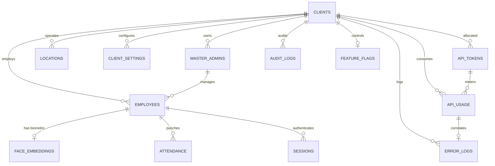

# Phase 1: Enterprise System Analysis & Architecture Specification

**Product**: Multi-Tenant Face Recognition Attendance SaaS Platform  
**Target System**: Super Admin Operational Portal & Forensic Control Plane  
**Reference Assets Verified**: Live portal at `faceapidocs.vercel.app`, local repository `face-attendance-docs`, Railway Face Recognition Engine, Cloudflare R2 Vector Storage, and Convex database specifications.  
**Verification Date**: October 2026  

---

## 1. Executive System Analysis

The Face Recognition Attendance SaaS platform is a distributed, multi-tenant enterprise solution providing high-availability biometric authentication, anti-spoofing facial verification, GPS geofencing, and workforce shift attendance tracking.

### System Verification Matrix

| Subsystem | Stated Infrastructure | Current Implementation Status | Verification Details |
| :--- | :--- | :--- | :--- |
| **Face Recognition Engine** | Python 3.11, InsightFace (ArcFace), Railway Microservice | **Deployed & Operational** | Generates 512-dimension vectors with cosine similarity threshold >= 0.850. Anti-spoofing liveness scoring. |
| **Biometric Vector Vault** | Cloudflare R2 Object Storage | **Integrated** | Opaque references (`faceId`: `FACE_xxx_xxxxx`) stored in DB; raw biometric vectors stored encrypted at rest in R2. |
| **Documentation Portal** | Next.js 16, Vercel | **Live & Verified** | Live at `faceapidocs.vercel.app` with embedded Swagger UI, Mermaid flowcharts, and documentation. |
| **Database Tier** | Convex Reactive Document Store | **Schema Specified (13 Collections)** | Complete 13 collections designed with compound indexes (`clientId`, `date`, `requestId`, `status`). |
| **Super Admin Web Portal** | Next.js, TypeScript, Tailwind | **Under Implementation (This Task)** | Dedicated control plane for global fleet management, tenant lifecycle, request tracing, and token metering. |

---

## 2. Verified API Inventory

The OpenAPI 3.0.3 catalog defines **22 REST endpoints** operating across three distinct environments:

### Base URLs
- **Development (DEV)**: `https://api-dev.faceattend.com/v1`
- **User Acceptance Testing (UAT - Token Metered)**: `https://api-uat.faceattend.com/v1`
- **Production (PROD)**: `https://api.faceattend.com/v1`

### Authentication & Standard Request Headers
```http
Authorization: Bearer <JWT_ACCESS_TOKEN>
x-api-key: <HASHED_API_TOKEN_KEY>
x-client-id: <CLIENT_ID>
X-Request-Id: REQ-YYYYMMDD-XXXXXX
Idempotency-Key: <UUIDv4>
Content-Type: application/json
```

### Verified Endpoints Catalog

| HTTP Method | Path | Scope Required | Description |
| :--- | :--- | :--- | :--- |
| `POST` | `/auth/face-login` | Public / Mobile Device | Authenticate employee via 1:1 biometric camera capture |
| `POST` | `/clients` | `super_admin:write` | Provision new enterprise client / tenant |
| `GET` | `/clients` | `super_admin:read` | List all tenant clients with status and environment |
| `GET` | `/clients/{clientId}` | `client:read` | Retrieve specific client tenant configuration |
| `PATCH` | `/clients/{clientId}` | `super_admin:write` | Update client tenant metadata, status, environments |
| `POST` | `/employees` | `master:write` | Register new employee profile in tenant directory |
| `GET` | `/employees` | `master:read` | Query employee directory with strict `clientId` filter |
| `GET` | `/employees/{employeeId}` | `employee:read` | Retrieve employee profile and biometric registration status |
| `PATCH` | `/employees/{employeeId}` | `master:write` | Update employee department, role, or active status |
| `POST` | `/face/register` | `face:register` | Extract and persist 512-d embeddings in R2; returns `faceId` |
| `POST` | `/face/verify` | `face:verify` | Real-time 1:1 facial comparison against enrolled vector |
| `POST` | `/attendance/check-in` | `attendance:check_in` | Biometric punch + GPS geofence validation + duplicate check |
| `POST` | `/attendance/check-out` | `attendance:check_out` | Shift completion and net active duration calculation |
| `GET` | `/attendance/records` | `attendance:read` | Query historical punch cards by date range |
| `POST` | `/locations` | `master:write` | Register approved corporate geofence location |
| `GET` | `/locations` | `master:read` | List corporate office geofences |
| `PATCH` | `/locations/{locationId}` | `master:write` | Update geofence coordinates or radius threshold |
| `GET` | `/api-usage` | `usage:read` | Aggregated metered request metrics by tenant/endpoint |
| `GET` | `/api-usage/{requestId}` | `usage:read` | End-to-end execution trace for single Request ID |
| `GET` | `/audit-logs` | `audit:read` | Query immutable state mutation audit trail |
| `GET` | `/error-logs` | `error:read` | Query application diagnostic error traces |
| `GET` | `/error-logs/{requestId}` | `error:read` | Detailed diagnostic stack trace for specific Request ID |
| `POST` | `/tokens` | `tokens:provision` | Allocate and issue new UAT / Production API credentials |
| `GET` | `/tokens` | `tokens:read` | List masked tokens and remaining quota balances |
| `POST` | `/tokens/{tokenId}/rotate` | `tokens:rotate` | Invalidate secret and generate new credential |
| `POST` | `/tokens/{tokenId}/revoke` | `tokens:revoke` | Immediately disable token (subsequent calls return 401) |
| `GET` | `/feature-flags/{clientId}` | `flags:read` | Fetch client-specific active capability toggles |
| `PATCH` | `/feature-flags/{clientId}` | `flags:write` | Modify client-specific feature flag toggles |

---

## 3. Database & Entity Relationship Analysis

The platform defines **13 primary collections** in Convex:



### Collection Definitions & Compound Indexes

1. **`clients`**: `clientId` (unique), `companyName`, `companyLogo`, `status` (`ACTIVE` | `SUSPENDED` | `TRIAL`), `environment` (`DEV` | `UAT` | `PROD`), `subscriptionPlan`, `createdAt`, `updatedAt`.
2. **`masterAdmins`**: `masterId` (unique), `clientId` (FK), `name`, `email`, `role`, `status` (`ACTIVE` | `INVITED` | `DISABLED`), `createdAt`. Index: `["clientId"]`.
3. **`employees`**: `employeeId` (unique per client), `clientId` (FK), `masterId` (FK), `faceId` (opaque R2 pointer), `name`, `email`, `department`, `designation`, `status` (`ACTIVE` | `PENDING_FACE_REGISTRATION` | `TERMINATED`). Compound index: `["clientId", "isActive"]`, `["clientId", "employeeId"]`.
4. **`attendance`**: `_id`, `clientId`, `masterId`, `employeeId`, `faceId`, `attendanceDate`, `loginTime`, `logoutTime`, `activeMinutes`, `status` (`PRESENT` | `LATE` | `HALF_DAY` | `OVERTIME`), `checkInLocation` (`latitude`, `longitude`, `distanceMeters`), `checkOutLocation`. Compound indexes: `["clientId", "date"]`, `["clientId", "employeeId", "date"]`.
5. **`face_embeddings`**: `faceId` (unique), `clientId`, `employeeId`, `vectorStoreKey` (R2 URI), `qualityScore`, `livenessVerified`, `algorithmVersion` (`InsightFace-ArcFace-v1.2`), `createdAt`.
6. **`locations`**: `locationId`, `clientId`, `locationName`, `latitude`, `longitude`, `allowedRadius` (meters), `status`. Index: `["clientId"]`.
7. **`settings`**: `clientId` (unique), `officeStartTime`, `officeEndTime`, `lateThreshold`, `timezone`.
8. **`api_tokens`**: `tokenId` (unique), `clientId`, `masterId`, `tokenHash` (SHA-256), `environment`, `allocatedTokens`, `usedTokens`, `remainingTokens`, `status` (`ACTIVE` | `REVOKED` | `EXPIRED`), `expiresAt`. Index: `["tokenHash", "status"]`, `["clientId", "environment"]`.
9. **`api_usage`**: `requestId` (unique), `clientId`, `masterId`, `employeeId`, `faceId`, `tokenId`, `apiName`, `endpoint`, `environment`, `status` (`SUCCESS` | `FAILED`), `responseTime`, `tokensConsumed`, `timestamp`. Index: `["requestId"]`, `["clientId", "timestamp"]`.
10. **`audit_logs`**: `_id`, `requestId`, `clientId`, `masterId`, `userId`, `userRole`, `action`, `resource`, `status`, `timestamp`. Index: `["clientId", "timestamp"]`.
11. **`error_logs`**: `_id`, `requestId`, `clientId`, `masterId`, `employeeId`, `apiName`, `errorCode`, `errorMessage`, `environment`, `timestamp`. Index: `["requestId"]`, `["clientId", "errorCode"]`.
12. **`feature_flags`**: `clientId` (unique), `faceRegistration`, `faceVerification`, `attendance`, `gpsValidation`, `reports`, `apiAccess`, `notifications`, `enabled`.
13. **`sessions`**: `sessionId`, `clientId`, `employeeId`, `deviceId`, `devicePlatform`, `status`, `loginTime`, `expiresAt`.

---

## 4. Multi-Tenant Isolation & Entity Relationships

### Hierarchical Model
```
Super Admin (Global Fleet Operator)
  └── Client / Tenant (clientId, e.g. ABC001)
        ├── Master Admin (masterId, e.g. MASTER001, strictly 1 clientId)
        │     └── Employees (employeeId, e.g. EMP0098)
        │           ├── Face Vector (faceId, e.g. FACE_abc_98124)
        │           └── Attendance Punches (attendanceId)
        └── API Tokens & Feature Flags (strictly isolated by clientId)
```

### Strict Isolation Rules
1. **No Cross-Tenant Parameter Tampering**: Master Admins cannot pass or mutate foreign `clientId` parameters. All Convex mutations and queries bind `clientId` from authenticated session claims.
2. **Biometric Vault Isolation**: Cloudflare R2 object keys are namespaced: `r2://face-vectors/{clientId}/{employeeId}/{faceId}.bin`.
3. **Database Index Enforcement**: Every transactional query uses composite indexes prefixed by `clientId`.
4. **Token Quota Isolation**: API tokens cannot deduct balances across tenant borders.

---

## 5. Request Tracking & Token Accounting Analysis

### Request ID Lifecycle (`REQ-YYYYMMDD-XXXXXX`)
1. **Generation**: Created at mobile client edge or API Gateway before execution.
2. **Propagation**: Carried through all microservices via `X-Request-Id` HTTP header.
3. **Correlated Timeline**:
   - `00.000s`: Edge Gateway receives request.
   - `00.025s`: Tenant & API token validation (active quota check).
   - `00.060s`: Feature flag enablement check.
   - `00.110s`: Geofence GPS Haversine verification.
   - `00.220s`: Railway Face Inference Core (ArcFace cosine comparison).
   - `00.230s`: Convex transactional write (attendance record creation).
   - `00.235s`: Quota deduction & Audit logging.
4. **Failure Traceability**: If any stage fails, the exact failure stage and error code are logged with the identical `requestId`.

### Token Accounting Mechanics
- **UAT Sandbox vs. Production**:
  - **UAT Tokens**: Metered quotas (e.g. 50,000 to 100,000 units) dedicated for sandbox testing and pre-flight validation.
  - **Production Tokens**: Production billing accounts with high volume quotas or post-paid enterprise billing.
- **Consumption Units**:
  - `POST /v1/face/verify`: 1 token.
  - `POST /v1/attendance/check-in`: 2 tokens (Face verification + Geofence calculation + punch write).
  - `POST /v1/face/register`: 5 tokens (Multi-angle embedding extraction and R2 storage).
- **Zero Raw Secret Exposure**:
  - Secrets are revealed **once** upon creation modal display.
  - Stored strictly as cryptographic SHA-256 hashes (`tokenHash`).
  - Rendered in UI exclusively masked (`uat_f9b8c2e1**********1234`).

---

## 6. Missing Requirements & Security Risks Identified

| Finding | Risk / Gap | Remediation Architecture |
| :--- | :--- | :--- |
| **No Dedicated Super Admin Portal** | Currently only public docs exist; operators cannot administer tenants or investigate issues. | Build dedicated Enterprise Super Admin web portal with 16 core sections. |
| **Simulated Token Operations in Docs** | Documentation website used client-side mock arrays. | Build realistic data store with stateful mutations, validation, and quota ledger. |
| **JWT vs. Quota Token Confusion** | Developers might confuse Bearer JWT sessions with API quota tokens. | Super Admin portal must clearly distinguish session JWTs from metered API keys. |
| **Biometric PII Protection** | Exposing raw embeddings or selfie photos in request traces violates GDPR/BIPA. | Request investigation must **never** display raw vectors or biometric matrices. |
| **Idempotency Duplication** | Retries during network blips could double-charge tokens or duplicate punches. | Implement strict 24h `Idempotency-Key` caching and single-charge guarantee. |

---

## 7. Proposed Super Admin Portal Information Architecture

1. **Overview Dashboard**: Fleet vitals, total tenants, active employees, API success rate, token consumption velocity.
2. **Clients / Tenants**: Tenant directory, status management (`ACTIVE`/`SUSPENDED`/`TRIAL`), onboarding wizard.
3. **Master Admins**: Corporate admin users, client-tenant assignment, credential reset, permissions.
4. **Employees**: Global directory search, biometric enrollment status, cross-tenant lookup.
5. **API Management**: Endpoint catalog, latency SLA monitors, rate limit thresholds.
6. **Request Investigation Center**: Global forensic trace by `requestId`, timeline reconstruction, failure diagnostics.
7. **API Usage & Token Billing**: Metered request trends, quota depletion velocity, billable calculations.
8. **UAT Token Management**: Provision sandbox tokens, view quotas, rotate/revoke masked keys.
9. **Production Credentials**: Secure production API key management, rotation policies.
10. **Audit Logs**: Tamper-evident admin mutation trail with actor, action, timestamp, and trace ID.
11. **Error Logs**: Real-time exception feeds, error taxonomy filtering (`FACE_NOT_MATCHED`, `LOCATION_OUTSIDE_RADIUS`, etc.).
12. **Feature Flags**: Per-tenant capability toggle matrix (GPS, Face, Reports, Notifications).
13. **Environment Management**: DEV / UAT / PROD cluster status, deployment synchronization.
14. **Subscription Plans**: Starter, Professional, Enterprise tier definitions and tenant assignment.
15. **System Health**: Railway microservice latency, Convex response times, Cloudflare R2 availability.
16. **Security & Settings**: Super Admin RBAC, IP allowlists, KMS encryption keys, session policies.
