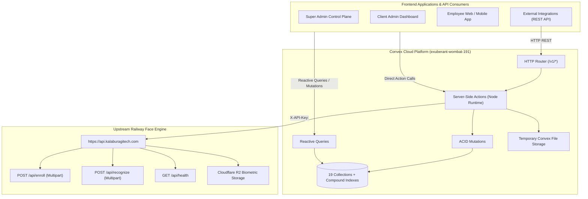

# Enterprise Multi-Tenant Face Recognition Attendance Convex Backend

Comprehensive, multi-tenant Convex backend for the Face Recognition Attendance SaaS platform, integrated with the live Railway Face Recognition API (`https://api.kalaburagitech.com`).

---

## 1. System Architecture & Live Deployment

- **Convex Cloud URL**: `https://exuberant-wombat-191.convex.cloud`
- **Convex HTTP Actions URL**: `https://exuberant-wombat-191.convex.site`
- **Live Biometric Service (Railway)**: `https://api.kalaburagitech.com`
- **Biometric Storage Integration**: Cloudflare R2 object store (`face-biometrics-vault`)
- **Isolation Model**: Multi-tenant database schema with tenant-scoped compound indexes



---

## 2. Verified Face API Integration Contracts

All protected calls to `https://api.kalaburagitech.com` require header `X-API-Key: <ORG_API_KEY>`.

### 2.1 Face Registration (`POST /api/enroll`)
- **Content-Type**: `multipart/form-data`
- **Fields**:
  - `file`: image binary
  - `name`: employee name
  - `region`: region identifier (default `ka`)
  - `emp_id`: unique employee identifier
  - `emp_rank`: employee rank / role
- **Success Contract**:
  ```json
  {
    "success": true,
    "emp_id": "EMP-1001",
    "person_name": "Ravi Kumar",
    "face_encoding_id": 245,
    "faces_detected": 1,
    "processing_time": 1.47
  }
  ```

### 2.2 Face Recognition (`POST /api/recognize`)
- **Content-Type**: `multipart/form-data`
- **Fields**:
  - `file`: image binary
  - `region`: region identifier (default `ka`)
- **Success Contract**:
  ```json
  {
    "success": true,
    "total_faces": 1,
    "matches": [
      {
        "emp_id": "EMP-1001",
        "name": "Ravi Kumar",
        "match_score": 91.23,
        "distance": 0.18
      }
    ]
  }
  ```

---

## 3. Database Schema (19 Collections)

| Collection | Key Fields | Primary Indexes | Description |
| :--- | :--- | :--- | :--- |
| `clients` | `clientId`, `companyName`, `status`, `subscriptionPlan`, `faceApiKeyEncrypted` | `by_client_id`, `by_status` | Corporate tenant clients |
| `masterAdmins` | `masterId`, `clientId`, `name`, `email`, `role`, `status` | `by_master_id`, `by_client`, `by_email` | Tenant owner accounts |
| `clientUsers` | `userId`, `clientId`, `name`, `email`, `role`, `permissions` | `by_client`, `by_client_and_email`, `by_email` | HR Admins & Managers |
| `employees` | `employeeId`, `clientId`, `departmentId`, `faceId`, `faceEncodingId`, `status` | `by_client`, `by_client_and_emp_id`, `by_client_and_status` | Employee workforce directory |
| `departments` | `departmentId`, `clientId`, `name`, `headcount` | `by_client`, `by_client_and_name` | Corporate departments |
| `shifts` | `shiftId`, `clientId`, `startTime`, `endTime`, `gracePeriodMinutes` | `by_client`, `by_client_and_status` | Work schedules |
| `attendance` | `attendanceId`, `clientId`, `employeeId`, `attendanceDate`, `checkInTime`, `checkOutTime`, `status`, `activeMinutes` | `by_client`, `by_client_and_date`, `by_client_emp_date`, `by_request_id` | Historical & live punch cards |
| `locations` | `locationId`, `clientId`, `latitude`, `longitude`, `allowedRadiusMeters` | `by_client`, `by_client_and_status` | Approved GPS geofences |
| `attendancePolicies` | `policyId`, `clientId`, `minWorkingHoursStandard`, `halfDayHours`, `overtimeThresholdMinutes` | `by_client` | Shift thresholds |
| `clientSettings` | `clientId`, `officeStartTime`, `officeEndTime`, `lateThresholdMinutes`, `minMatchScore`, `maxMatchDistance` | `by_client` | Biometric & office thresholds |
| `feature_flags` | `clientId`, `faceRegistration`, `faceVerification`, `attendance`, `gpsValidation` | `by_client` | Capability toggles |
| `faceRegistrations` | `registrationId`, `clientId`, `employeeId`, `faceEncodingId`, `vectorStorageRef` | `by_client`, `by_client_and_employee`, `by_face_encoding` | Biometric enrollment ledger |
| `api_tokens` | `tokenId`, `clientId`, `tokenHash`, `tokenMasked`, `environment`, `allocatedTokens`, `remainingTokens` | `by_token_hash`, `by_client`, `by_client_and_env` | Metered UAT & Prod API keys |
| `api_usage` | `requestId`, `clientId`, `endpoint`, `operation`, `responseTimeMs`, `tokensConsumed`, `status` | `by_client`, `by_request_id`, `by_client_and_timestamp` | SaaS request telemetry |
| `audit_logs` | `auditId`, `requestId`, `clientId`, `actorEmail`, `action`, `outcome` | `by_client`, `by_client_and_action`, `by_request_id` | Immutable state mutation trail |
| `error_logs` | `errorId`, `requestId`, `clientId`, `errorCode`, `errorMessage`, `stackTrace` | `by_client`, `by_request_id`, `by_client_and_error_code` | Diagnostic exception logs |
| `notifications` | `notificationId`, `clientId`, `title`, `message`, `severity`, `isRead` | `by_client`, `by_client_and_read` | System and attendance alerts |
| `idempotencyKeys` | `key`, `clientId`, `operation`, `response`, `expiresAt` | `by_key`, `by_client` | 24-hour duplicate suppression |
| `superAdmins` | `adminId`, `name`, `email`, `status` | `by_email` | Global fleet operators |

---

## 4. REST API Reference (Convex Site: `https://exuberant-wombat-191.convex.site`)

### Standard Request Headers
```http
x-client-id: <CLIENT_ID>
x-api-key: <HASHED_API_KEY> (Optional or required for metered clients)
X-Request-Id: REQ-YYYYMMDD-XXXXXX (Optional, server generates if missing)
Idempotency-Key: <UUIDv4> (Optional, prevents duplicate punches for 24h)
Content-Type: application/json
```

### Endpoints Catalog

1. **`GET /v1/health`**: Health status and environment check.
2. **`POST /v1/attendance/check-in`**:
   - Body: `{"employeeId": "EMP-1001", "faceImageBase64": "data:image/jpeg;base64,...", "latitude": 17.3297, "longitude": 76.8343}`
   - Performs: Haversine geofence check, upstream face recognition, 1:1 / 1:N identity resolution, duplicate punch suppression, late arrival calculation, telemetry and audit logging.
3. **`POST /v1/attendance/check-out`**:
   - Body: `{"employeeId": "EMP-1001", "faceImageBase64": "data:image/jpeg;base64,...", "latitude": 17.3297, "longitude": 76.8343}`
   - Performs: Biometric verification, open punch resolution, active duration calculation (`activeMinutes`), half-day / overtime evaluation, punch closure.
4. **`POST /v1/face/verify`**:
   - Body: `{"employeeId": "EMP-1001", "faceImageBase64": "data:image/jpeg;base64,..."}`
   - Performs: Upstream face comparison, threshold verification without writing attendance punch.
5. **`POST /v1/face/register`**:
   - Body: `{"employeeId": "EMP-1001", "name": "Ravi Kumar", "faceImageBase64": "data:image/jpeg;base64,...", "consentConfirmed": true}`
   - Performs: Biometric consent verification, multipart `/api/enroll` upstream call, employee profile activation, enrollment ledger entry.

---

## 5. Local Setup & Testing

### Installation
```bash
npm install
```

### Type Checking
```bash
npm run typecheck
```

### Automated Tests
```bash
npm test
```
The test suite validates:
- `REQ-YYYYMMDD-XXXXXX` format and date parsing
- SHA-256 token hashing and masking
- Server-side authenticated credential encryption / decryption
- Haversine spherical distance calculation
- Geofence verification against approved perimeters
- Base64 to binary buffer conversions
- Live upstream Face API connectivity (`https://api.kalaburagitech.com/api/health`)
- Working duration and shift calculations

### Convex Synchronization
```bash
npm run codegen
npm run dev
```
